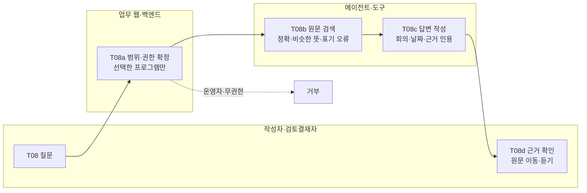

# 개선 업무 흐름 — T08 지난 회의 조회

v0.2 | 2026-10-22 | 검토용 초안 · 챗봇 추가안 (기준: 02_Swimlane_ToBe v0.1)

본 문서는 방송작가 인터뷰를 가상 제작사 에그이즈고잉에 적용한 설계 초안이다. 실제 에그이즈커밍의 조직 운영이나 AIR Studio의 확정 API를 설명하지 않는다.

## 사람과 시스템의 책임

T08은 **조회 전용** 단계다. 챗봇은 회의 원문을 찾아 보여 줄 뿐, 회의록·결정·업무·결재 상태를 바꾸지 않는다. 업무 웹은 검색 범위(프로그램)와 권한을 정하고, 에이전트는 주어진 범위 안의 원문만 근거로 답한다. 기존 T01~T07 흐름과 독립적으로, 어느 화면에서든 시작할 수 있다.

## 흐름

## 인계 조건과 요구사항 연결

| 단계 | 책임과 완료 조건 | 요구사항 |
|---|---|---|
| T08 질문 | 사용자가 채팅 창에 질문을 입력 (300자 이내) | FR-11 |
| T08a 범위 확정 | 백엔드가 로그인 사용자·**현재 선택한 프로그램**·내용 열람 권한을 확인. 검색 범위를 그 프로그램의 회의로 고정 | FR-08, FR-11 |
| T08b 원문 검색 | 프로그램 안 모든 회의의 최신 전사(없으면 등록된 녹취록)를 검색. 정확한 단어 → 비슷한 뜻 → 표기 오류 순으로 점수 | FR-11, FR-12 |
| T08c 답변 | 찾은 발언(Claude 모드는 그 발언이 나온 회의 원문 전체)만 근거로 답변. 여러 회의면 날짜순 종합, 바뀐 결정은 최신 회의 기준 | FR-11 |
| T08d 근거 확인 | 결과마다 회의 이름·날짜·시간 표시, 원문 위치로 이동, 해당 발언 듣기 | FR-02, FR-13 |
| 기록 (적용됨) | 질문 1건당 조회 기록 1행 (`AuditEvent`). 원문·질문 본문은 남기지 않음 | FR-14a |

## 예외 처리

| 조건 | 다음 행동 | 사용자 표시 |
|---|---|---|
| 로그인 안 함 | 검색 거부 (401) | 채팅 버튼 숨김 |
| 운영자 역할만 있음 | 검색 거부 (403) — 기준 문서 "녹음·문서 내용 접근은 별도 허용" | "운영자 권한으로는 회의 내용을 검색할 수 없어요" |
| 다른 프로그램 지정 시도 | 멤버십이 없는 프로그램은 무시하고 사용자의 기본 프로그램으로 고정 | 시트 머리의 범위 칩에 실제 검색 범위 표시 |
| 프로그램 전환 | 이전 대화를 지우고 새 범위로 시작 | 범위 칩의 프로그램 이름 변경 |
| 검색할 단어 없음 | 검색하지 않음 | "검색할 단어를 찾지 못했어요…" + 다시 묻는 방법 안내 |
| 검색 결과 없음 | 답변을 지어내지 않음 (AI도 부르지 않음) | "이 프로그램 회의 원문에서 …와 관련된 내용을 찾지 못했어요" |
| AI 호출 실패 | 규칙 기반 검색 결과로 답변 (검색은 항상 동작) | 답변 아래 작은 안내 — 검색어 확장 실패 "AI 연결에 실패해서 기본 사전으로 찾았어요." / 답변 작성 실패 "AI 답변 작성에 실패해서 검색 결과만 정리했어요." (상세 오류는 서버 로그에만) |
| AI 정리 전 회의 | 전사가 없으면 등록된 녹취록을 줄 단위로 검색 | 원문 보기는 회의 작업실로 이동 (발언 위치 지정 없음) |

## 운영 확인

T08은 실행 상태(Run)·업무 상태(DocumentVersion)를 만들거나 바꾸지 않는다. 챗봇 답변은 승인된 회의록이 아니므로, 결과에는 원문 근거를 함께 보여 사용자가 직접 확인하게 한다. **[기준 문서와 차이]** 기준 문서의 AI 실행은 모두 Run으로 관리하지만, 챗봇은 회의 하나에 묶이지 않는 짧은 조회라 Run을 만들지 않는다 (05_AIR_연계 참고).
