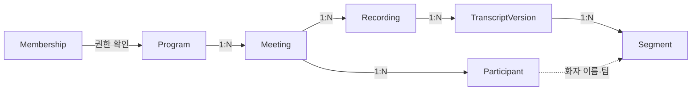

# AI 챗봇 데이터 영향

v0.2 | 2026-10-22 | 검토용 초안 · 챗봇 추가안 (기준: 04_ERD v0.1)

본 문서는 방송작가 인터뷰를 가상 제작사 에그이즈고잉에 적용한 설계 초안이다. 실제 에그이즈커밍의 조직 운영이나 AIR Studio의 확정 API를 설명하지 않는다.

## 요약

현재 구현은 **새 개체를 만들지 않는다.** 기존 개체를 읽고, 조회 기록만 기존 `AuditEvent`에 쓴다. `prisma/schema.prisma`는 바뀌지 않았다.

## 읽는 개체

| 개체 | 읽는 필드 | 용도 |
|---|---|---|
| Membership | program_id, user_id, role | 프로그램 소속·운영자 여부 확인 |
| Program | id, name | 검색 범위, 시트의 범위 칩 표시 |
| Meeting | id, program_id, title, occurred_at | 결과의 회의 이름·날짜, 발언 실제 시각 계산(occurred_at + start_ms) |
| Participant | id, display_name, team, role_label | 화자 이름, 화자 옆 팀 색·직함 표시 |
| Recording | kind, object_key, content_text | 전사 전 녹취록 검색, 음성 파일 위치 |
| TranscriptVersion | 회의별 **최신 1개** | 정정이 반영된 원문 사용 |
| Segment | seg_key, speaker_participant_id, start_ms, end_ms, text | 검색 대상, 녹음 위치, 원문 이동 |

## 쓰는 개체

| 개체 | 상태 | 주요 필드 | 제약과 의미 |
|---|---|---|---|
| AuditEvent (기존) | **적용됨** | organization_id, actor_id, action=`chatbot.search` / `chatbot.search_denied`, target_type=`Program`, target_id | 질문 1건당 1행. **원문 본문 대신 최소 식별정보** (기준 ERD 규칙) |
| ChatbotUsage (신규) | 보류 (Claude 모드 도입 시) | id PK, user_id, program_id, provider, model, prompt_version, tokens_in, tokens_out, latency_ms, hit_count, created_at | 질문·답변 본문 저장 금지. schema 맨 아래에 추가만 하고 기존 개체는 바꾸지 않음 |

기존 `StepRun`(토큰 필드 보유)을 쓰지 않는 이유: StepRun은 `Run → Meeting` 하나에 묶인 업무 실행 단계라서, 여러 회의를 가로지르는 조회를 넣으면 실행 상태 화면과 업무 시간 측정이 섞인다.

## 설계 규칙

- 모든 조회는 `Meeting.program_id = 현재 프로그램` 조건으로 시작한다. 프로그램이 다른 회의로 이어지는 조회 경로는 없다.
- 현재 프로그램은 멤버십이 있는 프로그램 중에서만 고른다 (`activeProgram`). 쿠키 값만으로 범위를 바꿀 수 없다.
- 별도 검색 인덱스를 두지 않으므로, 기준 ERD의 "삭제 정책은 검색 인덱스까지 반영" 규칙은 원문 삭제 즉시 자동 충족된다. 나중에 인덱스(AIR Data·Vector DB)를 도입하면 삭제 연동을 함께 설계한다.
